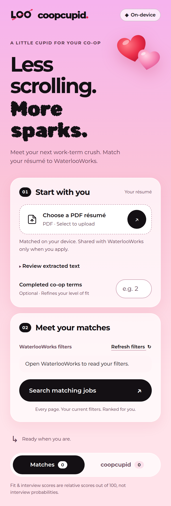

<p align="center"></p>

<h1 align="center">CoopCupid</h1>

<p align="center">
  
  
  
</p>

A Chrome extension that matches a résumé to the student's current WaterlooWorks
search, scores opportunities locally, and applies to eligible jobs saved in a
WaterlooWorks folder named **coopcupid**. No AI backend, API keys, or CoopCupid account.

<p align="center"></p>

## Install for development

Requires Node 24+ and current Chrome (155+).

```sh
npm ci
npm run build
```

1. Open `chrome://extensions`, enable **Developer mode**, choose **Load unpacked**,
   and select this repository's `dist/extension` directory.
2. Sign into WaterlooWorks and open **Jobs / Applications → All Jobs** in table
   view. Select and apply any filters in WaterlooWorks.
3. Click the CoopCupid toolbar icon to open its side panel.
4. Upload a PDF résumé. Check the extracted text; scanned PDFs need pasted text.
5. Click **Refresh filters**, then **Search matching jobs**. Search creates or
   reuses `coopcupid`, starts at the first page of the current results, and reads
   every filtered page. Keep the tab open and avoid changing its filters while
   searching. **Stop** preserves partial results. Scanning changes the visible
   results page as it progresses.
6. Save jobs using **Add to CoopCupid**, or add them directly in WaterlooWorks. Saved
   jobs have a **Remove from CoopCupid** button. To save a batch, choose an
   interview score cutoff and click **Add matching jobs to coopcupid**. Enable
   **Automatically save after each completed search** to reuse that cutoff.
7. Open the **coopcupid** tab in the panel, click **Auto apply**, review the job
   count and selected résumé, then start the batch. The original uploaded PDF is
   used, including when matching text has been corrected. WaterlooWorks limits
   the résumé upload to 5 MB.

## Behavior

- **Fit:** recognized skill coverage (65%), BM25 relevance within the result set
  (25%), and title overlap (10%). Optional completed work terms add a level
  mismatch penalty. Missing skills are shown as possible gaps, not asserted
  mandatory requirements.
- **Interview:** 85% fit and 15% competition, using applicant counts and openings
  where available. Missing competition gets a neutral value. Both scores are
  relative heuristics out of 100, **not interview probabilities**. They can
  change with the search corpus. Results sort by interview score, then fit.
- **Folder:** case-insensitive reuse of the real WaterlooWorks `coopcupid`
  folder. Folder view reads live membership, including jobs outside the last
  search results. Remove jobs from either view. Optional automatic saving adds
  jobs strictly above the chosen interview score after a completed search;
  partial or failed searches do not trigger it. The batch button works on all
  current results, including those beyond the displayed page, and skips live
  folder members. Stop preserves confirmed additions. The cutoff and automatic
  saving preference are stored locally. Removed jobs can qualify again on a
  future search if automatic saving is enabled.
- **Applications:** checks all queued folder jobs sequentially regardless of
  score. Rechecks membership and eligibility after preparing the package.
  Creates a custom package, uploads the selected résumé, and preserves existing
  required transcript/work-history selections. Does not select optional cover
  letters or other documents. Skips cover letters, screening, external flows,
  extra required documents, missing transcript/history selections, and unknown
  steps. Additional instructions requesting an action require review.
- **Progress:** preparation and outcomes appear in the panel. Stop prevents the
  next submission; an already-sent request may finish. Closing the panel stops
  orchestration. No automatic restart or blind retry after an uncertain result.
  An affected application tab remains available for review after a failure.
- **Tracking:** application history features remain out of scope. A local last
  batch record and interrupted-submission marker exist solely for recovery.

## Data and integration boundary

PDF parsing, ranking, résumé storage, and cached descriptions stay in the
extension's local IndexedDB. Applying uploads the PDF to WaterlooWorks in the
student's authenticated session. There is no analytics, remote matching call,
or central posting database. **Clear local data** removes the browser copy;
documents already uploaded to WaterlooWorks remain there.

The page bridge reads live action identifiers from WaterlooWorks' own loaded
functions; no captured session action or credential is shipped in the extension.
The adapter uses the supplied October 2026 page structure and fails explicitly
when it does not recognize an operation. Automated reads are paced. Real
HTML captures are ignored by Git; only scrubbed structural fixtures are committed.

`packages/core` remains board-agnostic and runs in Node and browsers. The Chrome
surface and WaterlooWorks bridge live under `surfaces/extension`.

## Checks and verification limits

```sh
npm run check        # TypeScript core + ranking, board, and workflow tests
npm run build        # Packaged extension; local PDF worker included
npm run test:browser # Isolated headless Chrome; no user account access
```

The Chrome smoke test uploads a generated PDF, extracts its text, scans mock
pages, ranks jobs, saves a folder job, and confirms a mock application batch.
Application-page tests exercise the wizard structure and response handling
with scrubbed fixtures. These checks do **not** establish that a live
WaterlooWorks session accepts the full flow. Live verification with a student
account is still needed before distribution. Tests submit no real applications.

Existing `coopmatch` WaterlooWorks folders and local résumé data remain available after the CoopCupid rename. New folders use `coopcupid`.

## License

[MIT](LICENSE) © 2026 Alexander Pershukevich. Bundled fonts (Montserrat, Rubik
Bubbles) are under the SIL Open Font License; see `surfaces/extension/fonts/`.
